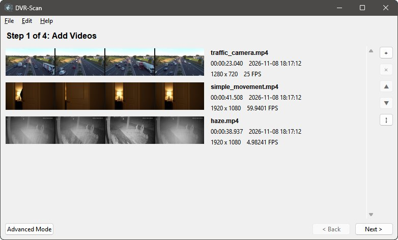
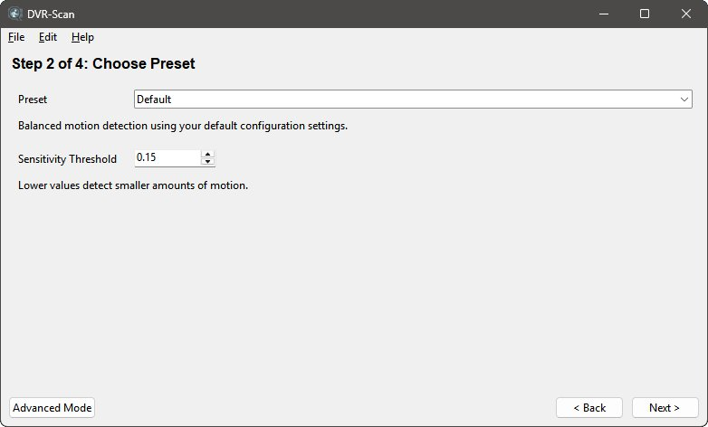
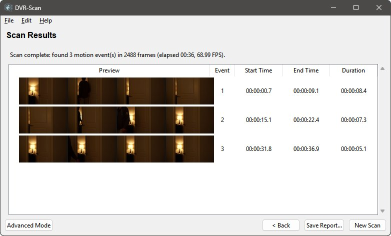
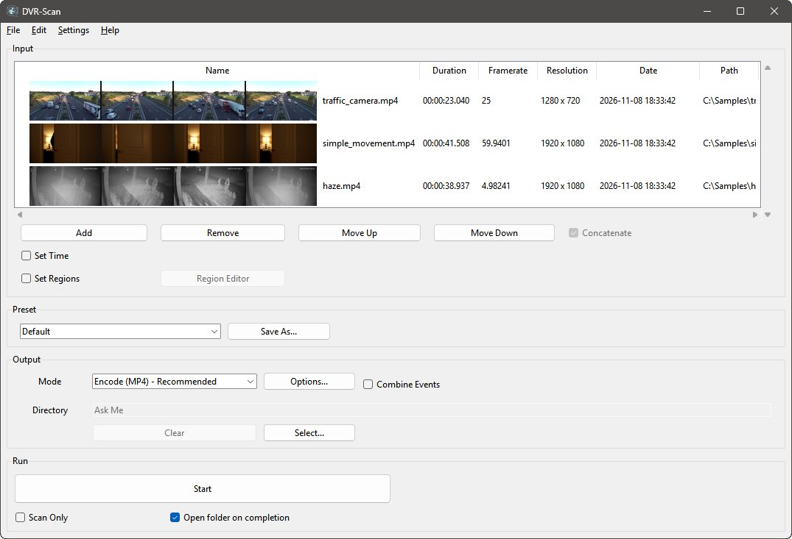
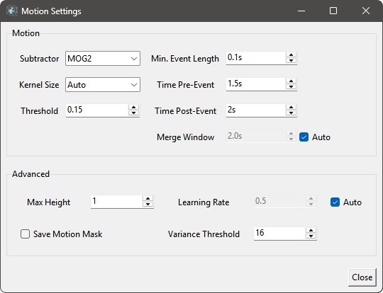
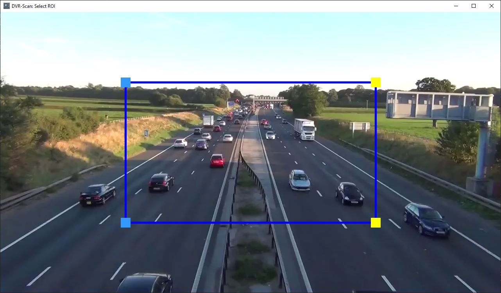
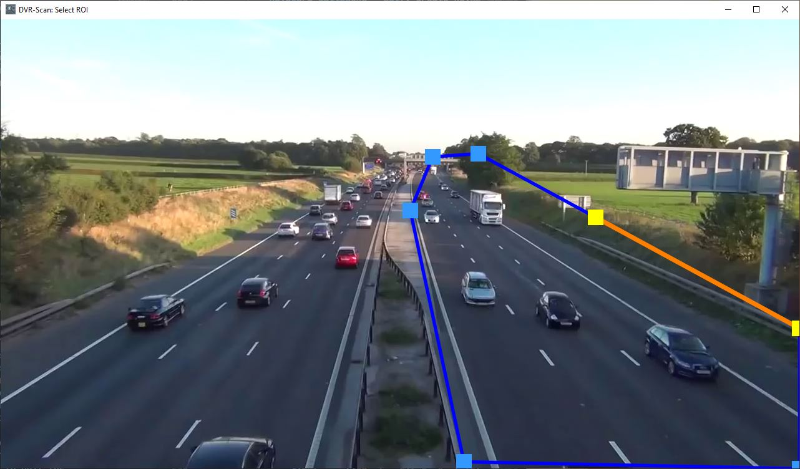
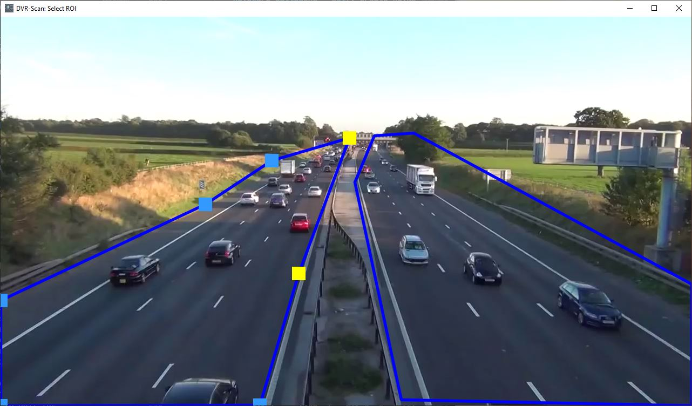
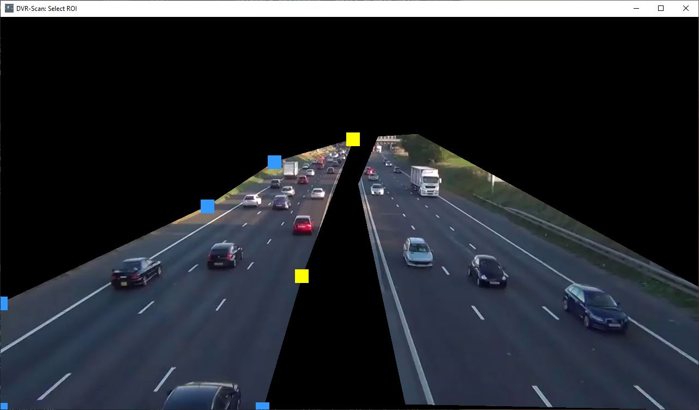

# :fontawesome-solid-circle-info: User Guide

After installation, launch the DVR-Scan application from its shortcut, or by running `dvr-scan-app` from a terminal (`dvr-scan-app.exe` in the portable version).

DVR-Scan has two views:

 - <b>[Scan Wizard](#scan-wizard)</b>: walks you through a scan step by step (add videos, pick a preset, choose an output folder, and scan).
 - <b>[Advanced Mode](#advanced-mode)</b>: shows all input, region, output, and detection settings in a single window.

You can switch between them at any time using the <b>Advanced Mode</b> button in the wizard, or <b>File -> Scan Wizard</b> in Advanced Mode. To change which view opens by default, use <b>File -> Startup Mode</b> in either view (new installs start in the wizard, while existing installs keep Advanced Mode; see [`startup-mode`](docs.md#config-file) for details).

!!! note "For the `dvr-scan` command-line interface and config file options, see the [Documentation](docs.md) page."

## :fontawesome-solid-wand-magic-sparkles:Scan Wizard

The wizard opens on the <b>Add Videos</b> step. Click the drop zone (or drag and drop files onto the window) to add one or more videos, then press <b>Next</b>:

Next, pick a <b>Preset</b>. <b>Default</b> uses your saved settings, <b>High Sensitivity</b> catches faint or small motion, <b>Low Sensitivity</b> reduces false detections, and <b>Fast Scan</b> trades accuracy for speed (see [Presets](docs.md#presets) for the settings each one changes). You can also adjust the sensitivity threshold directly, where lower values detect smaller amounts of motion (if motion you expect is not detected, see [this FAQ entry](faq.md#why-is-some-motion-not-detected-or-why-are-there-false-detections)):

On the <b>Choose Output</b> step, select how events should be saved (or <b>Scan Only</b> to just produce a report), review your choices, and press <b>Start Scan</b>. The scan runs in place, and the detected events are listed when it finishes:

## :fontawesome-solid-sliders:Advanced Mode

Advanced Mode gives you direct access to all scan settings, the [Region Editor](#region-editor), and start/end times in a single window. Add one or more videos by clicking the <b>Add</b> button or dragging and dropping files onto the window:

You can select several videos at once with Shift-click, Ctrl-click, or Command-click on Mac. Select every video with `Ctrl + A` (`Command + A` on Mac). To remove the selected videos, use the `Delete` key or the <b>Remove</b> button. These actions are also available from the <b>Edit</b> menu.

To extract and save the motion events from the input, click the <b>Start</b> button. You will be prompted for a location to save the events to, after which scanning will begin in a separate progress window. Once complete, each event will be saved to the output folder you selected.

To tune motion sensitivity, go to <b>Settings -> Motion</b> and adjust the threshold, where lower values are more sensitive to motion and higher values are less sensitive. You can also adjust event settings and more:

See [the config option documentation](docs.md#config-file) for a detailed description of each setting.

## :fontawesome-solid-crop-simple:Region Editor

The Region Editor allows you to limit motion detection to specific areas of the frame. In Advanced Mode, once you have a video loaded, check <b>Set Regions</b> and press the <b>Region Editor</b> button (or run `dvr-scan -i video.mp4 -r` from the command line):

You can use the mouse to add or move points when editing regions. Left click to add a new point, or drag an existing one. Right click can be used to delete a point, and to add/remove shapes.

To begin scanning, close the region editor, and click the <b>Start</b> button. You will be prompted to save the regions you have created before scanning so you can re-use them if required.

### Regions

Regions are a set of points creating a closed shape. A rectangle will be created by default for you to modify.

Regions are edited individually, but all regions are used when scanning. To add a new shape, right click anywhere on the frame.

Regions can be selected using the <b>Active Region</b> selector at the bottom left, or cycled by using the `Tab` key. Note that only one region can be edited at a time.

By enabling mask mode (<b>Toggle Mask</b> at the bottom right), you can see the exact areas of the frame that DVR-Scan will consider for motion:

Regions can be saved/loaded for reusing across videos or editing via the <b>File</b> menu.

### Controls

Click <b>Help -> Show Controls</b> or press `Ctrl + H` (`Command + H` on Mac) to display all keyboard and mouse controls. You can move the canvas by holding `Ctrl` (`Command` on Mac) and dragging with left-click. The cursor icon should change depending on what mode the editor is in.

Most actions have keyboard shortcuts displayed beside the menu item. You can undo/redo any modifications or deletions when working on the regions by clicking <b>Edit -> Undo/Redo</b> or using your system's undo/redo keys.
